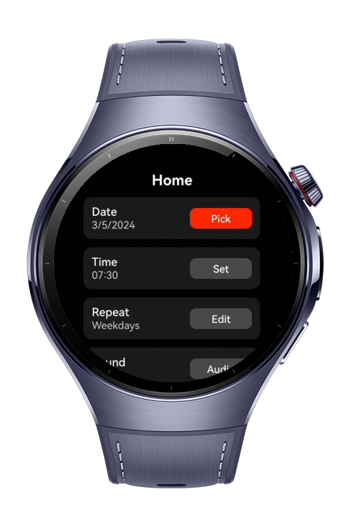
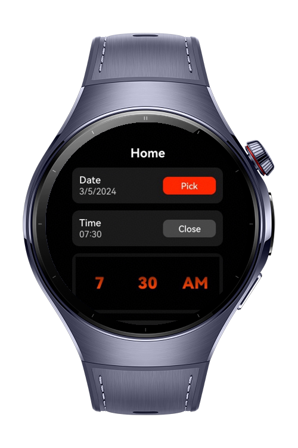
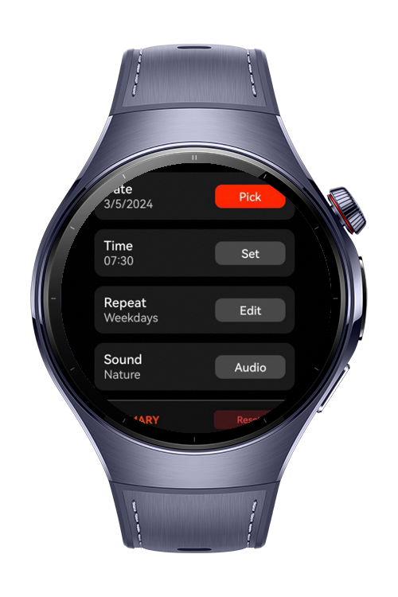
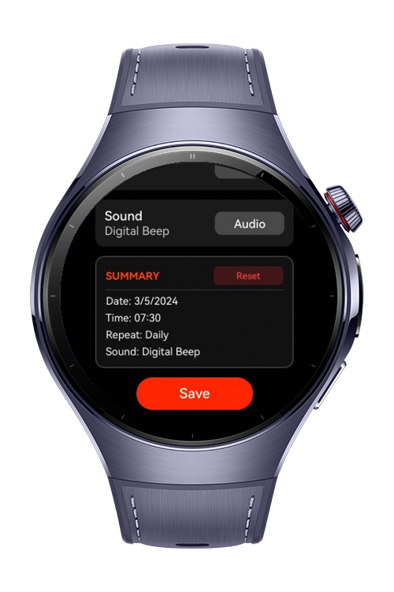

> **Note:** To access all shared projects, get information about environment setup, and view other guides, please visit [Explore-In-HMOS-Wearable Index](https://github.com/Explore-In-HMOS-Wearable/hmos-index).

# How to Build Picker Dialogs

The `how-to-build-picker-dialogs` codelab demonstrates an advanced scheduling interface on HarmonyOS using `@ComponentV2` state management to synchronize native dialogs and inputs—including `AlertDialogV2`, `ConfirmDialogV2`, `SelectDialogV2`, `TimePicker`, `CalendarPickerDialog`, and `TextPickerDialog` within a compact wearable screen layout.

# Preview

<div>
  
  
  
  
</div>

# Use Cases

- **State V2 Architecture**: Leverage modern `@ComponentV2` lifecycles and `@Local` state monitoring for streamlined UI rendering and seamless data flow.
- **Native Selection Pickers**: Integrate native `CalendarPickerDialog` and `showTextPickerDialog` with structured `TextPickerRangeContent` arrays for zero-friction user inputs.
- **Inline Time Picker Mutation**: Embed a reactive, expandable `TimePicker` that handles double-digit string formatting dynamically upon user modification.
- **Custom V2 Dialog Binding**: Decouple interactive flows into explicit modular sub-components like `SoundSelectDialog` and `ResetAlertDialog`, structured properly through `@Builder` methods.
- **Multi-lingual Resource String Injection**: Utilize the native `$r` framework alongside `ResourceStr` types to decouple presentation assets from layout blueprints.
- **Parameterized String Formatting**: Format runtime string patterns using resource-level placeholders (`%s`) to render dynamic variables seamlessly inside the `SummaryPanel`.
- **System Resource Evaluation**: Intersect component callbacks directly with the device `resourceManager` to resolve localized string variables programmatically during state changes.
- **Global Configuration Remapping**: Trigger nested component resets to easily re-initialize application-wide parameters back to factory settings via UI prompt interfaces.

# Tech Stack

- **Languages**: ArkTS / ArkUI
- **Frameworks**: HarmonyOS SDK 6.0.1(21)
- **Tools**: DevEco Studio, Hvigor
- **Libraries**:
    - `@kit.ArkUI`
    - `@kit.AbilityKit`

# Directory Structure
```
entry/src/main/
|---ets/
|   |---entryability/
|   |   |---EntryAbility.ets

|   |---components/
|   |   |---ResetAlertDialog.ets
|   |   |---SaveConfirmDialog.ets
|   |   |---SettingRow.ets

|   |   |---SoundSelectDialog.ets

|   |   |---SummaryPanel.ets

|   |---pages/
|       |---HomeScreen.ets
|---resources/
|   |---base/
|   |   |---element/
|   |   |   |---color.json

|   |   |   |---string.json

|---module.json5
```

# Constraints and Restrictions

- **Device Limitations**: Calling this dialog APIs on wearables will result in a runtime exception indicating that the API is undefined, whereas it functions correctly on other device types.
  - https://developer.huawei.com/consumer/en/doc/harmonyos-references/ts-methods-calendarpicker-dialog
  - https://developer.huawei.com/consumer/en/doc/harmonyos-references/ts-methods-datepicker-dialog
  - https://developer.huawei.com/consumer/en/doc/harmonyos-references/ts-methods-timepicker-dialog
  - https://developer.huawei.com/consumer/en/doc/harmonyos-references/ts-methods-textpicker-dialog
- **Screen Width Requirements**: `CalendarPickerDialog` requires a minimum window width of 386 vp for its content to display fully, which exceeds the layout capacity and screen width of most wearable devices.
- **Dynamic Theme Restrictions**: Native picker dialogs do not support dynamic light or dark color mode updates while they are actively open; the dialog must be closed and reopened to apply any new color mode or theme state changes.

## Supported Devices

- Huawei Watch Previewer

# License

`how-to-build-picker-dialogs` is distributed under the terms of the MIT License.
See the [LICENSE](LICENSE) for more information.